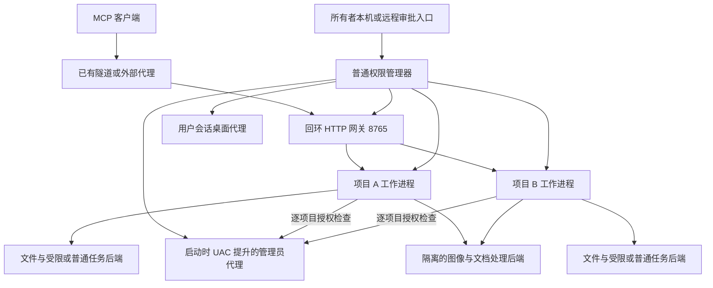

# ShellBot 架构与功能设计

2026 年 10 月 11 日增补：dev.16 / M9 已实现 [图像完整解码与缩放](IMAGE_VIEW.md)。C17 核心检查 PNG/JPEG 容器及有界 PNG 压缩数据，Windows 内置 WIC 解码全部像素并生成保持比例的 PNG 衍生图；复用文件句柄范围、审批和版本校验。当前处理位于原文件后端进程，独立解码器进程、旋转和其他格式仍为后续扩展。

2026 年 10 月 11 日增补：dev.15 / M8 已将 [Windows 桌面工具](DESKTOP_CONTROL.md)接入普通项目工作进程，跨管理器共享同账户/会话的受保护独占锁、暂停事件和观察版本；普通管理器持有会话状态以保留工作进程重启前的暂停。每项目复用既有审批和审计，管理员代理不参与，默认不启用桌面。底层采用 GDI/WIC 截图、Win32 窗口与 SendInput，控件树、浏览器语义和管理员桌面不在本次范围。

初始设计日期：2026 年 10 月 4 日；本次更新：2026 年 10 月 10 日。已确认采用多项目独立工作进程、独立 MCP 地址、解耦权限策略及按项目授权的共享管理员代理。dev.8 已完成 M1 配置与统一策略基础，见 [项目配置说明](PROJECT_CONFIGURATION.md)；多项目运行和其他新能力仍按里程碑开发。当前进度以 IMPLEMENTATION_STATUS.md 为准，迭代顺序以 [开发计划](DEVELOPMENT_PLAN.md) 为准。项目暂定名为 ShellBot。

当前独立仓库位于 E:\Program\ShellBot，Windows 工程为 WinShellBot。当前阶段集中制作 Windows 10 和 Windows 11 版本，WinShellBot 针对 Windows 优化；Linux 和 macOS 的兼容通过通用核心与平台接口边界预留。第一阶段既有范围与验收保留在 PHASE_1_PLAN.md；后续多项目和权限迭代以 DEVELOPMENT_PLAN.md 为准。

实现进度：0.1.0-dev.7 已有原生文件阅读、内容搜索、图像返回、创建、覆盖、局部替换、私有备份、本机审批与持久化审计，并加入三档执行权限的配置和身份基础层。管理员身份代理同账户启动、复用和退出已在 Server 2025 验收，跨账户提权仍未覆盖；普通/管理员后台任务已在 Windows 11 本机验证；完整受控隔离、规则和远程审批尚未实现。覆盖和替换当前采用锁定原文件并保留备份，不承诺崩溃原子性，见 FILE_EDIT.md。HTTP 监听本机端口，域名由已有代理负责，外部地址配置可选。

2026 年 10 月 6 日用户调整范围：暂缓公网 OAuth、配对网页和 cloudflared 管理，已有隧道已在其他程序验证，本程序只需监听本地端口，不要求域名检查。public_url 保留为可选限制，现有 bearer 与本机审批继续使用。下文 OAuth、隧道监管和原子保存属于后续目标；当前不开发 OAuth、隧道管理和域名探测，范围以 DEVELOPMENT_PLAN.md 为准。

2026 年 10 月 9 日确认新的项目权限模型，取代原三档身份自带审批的目标：文件范围、always/workspace_auto/never 审批、受限/普通/管理员身份及管理员使用许可分别配置。所有者可同时配置完整权限项目和目录内自动读写、命令审批的项目；共享代理只向已授权项目提供管理员操作，UAC 不自动授权其他项目。无人值守使用继续成立，具体边界和旧 dev.7 配置差异见 [项目权限与执行身份](EXECUTION_PERMISSIONS.md)。

建议把新项目做成独立的原生电脑 MCP 主机：GPT 通过它读取文件、查看图像和文档、运行程序、观察并操作桌面。Windows 10 和 Windows 11 是主要开发与验收平台；Windows 7 使用独立编译的兼容版，Windows 8.1 归入兼容版验证。架构从开始就预留 macOS 和 Linux 的平台接口。

## 产品定位与使用方式

用户在受控电脑安装本程序，配置各项目允许的功能、文件位置和权限，再把各自的 HTTPS MCP 地址接入兼容客户端；外部隧道由已有环境负责。用户可以从另一台电脑、手机或可用的浏览器发出指令；受控电脑无需安装 ChatGPT 桌面客户端，也无需安装 Node.js 或 Python。

GPT 的推理仍由连接的模型服务完成。本程序提供电脑访问与执行能力。初版不内置模型推理和聊天循环；程序本身能够继续运行已提交的后台任务，但新任务仍由 MCP 客户端发起。以后如需完全无人值守的持续代理，可以作为独立的 API 客户端扩展，单独管理模型凭据和费用。

ChatGPT 的远程 MCP 接入需要可用的连接功能，是否开放取决于账号及工作区政策。设计采用标准 MCP，也允许其他兼容客户端接入，避免把服务核心绑定在某一种客户端界面上。[OpenAI 接入说明](https://developers.openai.com/plugins/deploy/connect-chatgpt)

最终产品应支持这些典型任务：整理下载目录；查看图片并读取 PDF；修改配置与代码；运行测试或编译；启动软件并点击窗口中的控件；读取表格中的数据并另存为 CSV；查看电脑运行状态并诊断问题；在用户授权后管理后台任务。

## 现有项目评估

此次检查的源代码位于 E:\Program\CodexPro。现有两个项目主要贡献可沿用的设计经验，不适合逐行翻译为 C。

| 项目 | 当前检查到的状态 | 对新项目的意义 |
| --- | --- | --- |
| codexpro | TypeScript 和 Node.js，package.json 为 0.30.2，main，提交 482d003；存在用户未提交修改 | 借鉴 MCP 工具描述、文件读写与搜索、图像结果、路径限制、输出裁剪和错误处理 |
| CodexPro Manager | C# 和 .NET 8 WPF；当前分支 development/tunnel-recovery-20261003，提交 4a483f7；开发计划记录 0.1.2 候选版 | 借鉴进程归属、启动停止、隧道状态、断线退避、凭据脱敏和连接诊断 |

检查依据包括 codexpro 的 src/server.ts、src/http.ts、src/guard.ts、src/imageOps.ts，以及管理程序的 DEVELOPMENT_PLAN.md、Services/IInstanceRuntimeAdapter.cs、Services/McpConnectionProbe.cs、Services/CloudflaredReadiness.cs 和 Services/TunnelSupervisor.Recovery.cs。

| 决策 | 内容 |
| --- | --- |
| 保留设计 | 标准 MCP、明确授权范围、结构化结果、输出分页、隧道监管、可取消任务、真实连接状态 |
| 重新实现 | 网络和 MCP 层、进程执行、文件接口、认证、图像处理、跨平台适配、桌面控制 |
| 改变产品中心 | 从围绕代码仓库的工具，扩展为围绕一台电脑及其授权功能的工具 |
| 分离现有管理程序 | 新主机独立启动和配置；现有管理程序以后可通过公开接口管理它，但不作为运行前提 |
| 保持独立 | 新建第三个项目；现有源码修改、配置、运行实例与 Data 不自动迁移 |

现有 HTTP 实现允许通过 URL 查询参数携带长期令牌。新项目的公网使用采用标准授权流程，不把这一方式作为正式连接方案。旧诊断程序支持的协议版本有限，也不能直接作为新主机完整的验收客户端。

## 总体架构

网关、管理器和项目工作进程使用普通权限。每项目保存独立配置、凭据引用、任务、审批、备份和审计；管理器可以复用同一程序的启动角色，先提供命令行再做最小界面。管理员代理独立检查实际调用方、项目许可与操作条件，不直接监听公网。一次启动 UAC 只提升代理，不提升所有项目，也不改变各项目的审批策略。

当前 dev.7 是单主机配置和单主机代理，普通/管理员任务已有，多项目网关和共享授权待实现。保留当前真实令牌检查和 user 拒绝提升主机的行为；未来需要开机未登录运行时再提供首次安装授权的服务/计划任务。桌面代理属于真实用户会话，同一会话跨项目独占操作。

| 模块 | 职责与边界 |
| --- | --- |
| 网络与 MCP 网关 | 回环 HTTP、项目路径和认证绑定、协议适配、总请求与排队预算；stdio 固定一个项目 |
| 项目管理器 | 项目注册与本人工作进程启停、独立数据和凭据、可信管理员授权/撤销、最小管理界面 |
| 通用权限策略 | 工具开关、文件范围、审批、执行身份和策略版本复核；拒绝模型自行扩权 |
| 项目工作进程 | 单项目工具路由、任务归属、幂等记录、输出和并发预算；不以客户端字段切换项目 |
| 管理员代理 | 复用提升进程，逐项目和逐操作检查，只提供明确后端操作 |
| 平台后端 | 文件检查、编码、受限/普通进程、进程树清理及操作系统资源保护 |
| 桌面代理 | 屏幕、输入、窗口与剪贴板，跨项目用户会话独占租约 |
| 文档处理进程 | 复杂格式解析和渲染独立运行，限制资源并执行原项目文件策略 |
| 所有者管理与审批 | 身份独立于 MCP，配置及扩权仅本机管理；后续远程入口只处理绑定的操作审批 |
| 外部隧道 | 由用户已有环境提供；当前不安装、监管、探测域名或修改网络配置 |

本机通信验证实际对端和项目上下文，Windows 使用受保护命名管道，其他平台预留对应接口。进程拆分便于故障处理和多核调度，但不等于文件/网络沙箱；完整隔离仍需系统身份、对象权限及真实拒绝访问测试。管理员项目可影响整台电脑，需要抵抗管理员能力时采用虚拟机或独立系统。

## 最终功能范围

下面的功能表定义完整产品方向。基础版与扩展包共用同一套能力报告；未安装或未获授权的后端不显示为可用。

| 能力 | 最终可做的事情 | 第一版范围与扩展边界 |
| --- | --- | --- |
| 主机状态 | 查看系统、架构、版本、磁盘、内存、用户会话、功能和依赖状态 | 基础功能；报告当前电脑真实可用的能力 |
| 文件管理 | 列目录、读取、搜索、创建、复制、移动、改名、写入、修改、删除 | 覆盖常见文件操作；大文件采用分块传输；删除优先进入回收站 |
| 图像查看 | 返回可供模型查看的图片，缩放、裁剪、旋转，查询尺寸和格式 | PNG、JPEG 优先；WebP、GIF、BMP 和 TIFF 按后端能力扩展 |
| 文档阅读 | 提取正文、表格、页码、工作表和幻灯片内容 | 文本、PDF、DOCX、XLSX、PPTX；扫描件识别通过可选 OCR 后端 |
| 文档预览 | 把指定页面或区域转为图像，方便模型判断排版 | PDF 优先；Office 精确预览需要额外渲染后端 |
| 文档修改与生成 | 修改文本；导出 CSV；生成简单报告和表格；后续编辑 Office 文件 | 文本修改属基础功能；复杂 Office 编辑为独立扩展能力 |
| 命令与终端 | 执行程序、读取标准输出和错误、输入、超时、取消，支持后台任务 | Windows 使用本机命令环境，Linux 和 macOS 使用现有 shell；不要求另装 Bash |
| 桌面控制 | 截图、点击、双击、右键、拖动、滚动、文字输入、快捷键 | Windows 主版重点功能，支持多显示器和显示缩放 |
| 窗口与应用 | 列出窗口、切换窗口、打开文件与程序、读取可访问控件 | 窗口切换与应用启动先做；控件语义操作逐步加入 |
| 剪贴板 | 读取和写入文字，后续支持图像和文件列表 | 单独授权；首次以文字为主 |
| 浏览器 | 读取页面、点击和填写、管理授权下载，后续使用 DOM 操作 | 开始可通过桌面操作；专用浏览器会话采用原生协议适配 |
| 进程与系统操作 | 查看进程与使用量；结束指定进程；后续管理服务和电源 | 进程查询与本人启动任务的停止先做；系统级操作需要相应权限 |
| 任务与产物 | 查询后台工作、取消任务、获取输出和生成文件 | 所有耗时操作统一走任务机制 |
| 连接与管理 | 固定地址、连接授权、日志、暂停、诊断、升级与回滚 | 独立运行；原生本机设置和命令行均可使用 |

### 文档支持的具体含义

“支持某种文件”需要分别说明内容读取、视觉预览和编辑。客户端能收到文件下载地址，也不等于模型已经读懂该文件。

| 格式 | 内容读取 | 视觉预览 | 修改和生成 |
| --- | --- | --- | --- |
| TXT、Markdown、日志、代码 | 行范围、关键词、编码识别 | 一般不需要页面渲染 | 原子写入、局部修改、变更检查 |
| CSV、TSV | 指定行列、分页、列信息 | 简单表格结果 | 写入、修改与另存 |
| PDF | 有文本层时提取内容和页码 | 指定页面、裁剪区域、缩略图 | 初期不做任意原版重排；生成简单 PDF 可作为扩展 |
| DOCX | 段落、标题、表格、嵌入图像 | 需可选 Office 渲染后端 | 简单生成与有限修改作为扩展，不承诺无损复杂排版 |
| XLSX | 工作表、单元格、公式文本和已有缓存值 | 需渲染后端，或返回有界表格 | 简单表格生成与修改作为扩展；公式重新计算另需引擎 |
| PPTX | 幻灯片、文字、备注、嵌入媒体 | 需可选渲染后端 | 简单生成与有限修改作为扩展 |
| DOC、XLS、PPT | 后续转换后读取 | 依赖兼容转换后端 | 不列入基础版承诺 |
| 扫描 PDF 与图片中的文字 | 需 OCR 后端 | 可以直接返回图片给支持图像的模型 | OCR 结果需要保留页码、位置和置信信息 |

建议基础包内置文本、CSV、图像和 OOXML 内容提取；标准包增加 PDF 阅读与渲染；完整包按需加入 OCR 与 Office 转换。这样普通用户一次安装标准包即可完成常用阅读任务，追求小体积的用户仍可选择基础包。

PDF 引擎可采用 PDFium 的 C 接口，但其内部实现包含 C++，应放在单独组件中发布。macOS 的现代屏幕接口也可能需要很薄的 Objective-C 桥接。这里的 C 方案指主机核心和自有通用逻辑采用 C，发布时无需脚本运行环境；不把第三方组件的内部语言全部限制为 C。若后续确定整个依赖链也必须纯 C，需重新选择文档引擎并收窄部分能力。[PDFium 许可](https://pdfium.googlesource.com/pdfium/+/refs/heads/main/LICENSE)

### 图像和文件结果

图像查看与桌面截图返回 MCP 原生 image 内容块，并附上尺寸、裁剪范围、时间戳和产物编号。把 Base64 文字放进普通字符串结果，不能作为“模型已经看到图像”的实现标准。MCP 定义了原生图像结果；客户端实际如何使用仍需实测。[MCP 工具结果](https://modelcontextprotocol.io/specification/2026-07-28/server/tools)

大图片先缩略，模型需要细节时请求局部区域。文档按页、段落、单元格区域返回，不一次塞入整本书或整个表格。下载与上传使用独立的产物编号、分块接口或短期受限地址，不把任意本机文件路径变成公网下载入口。客户端专有附件导入另做适配，不假设所有 MCP 客户端都支持同一附件对象。

### 桌面控制的执行闭环

GPT 的操作顺序是观察屏幕和窗口、定位目标、执行动作、再次观察并判断结果。服务器负责提供准确的状态和动作结果，不能把“输入已经发送”直接报告为“业务任务已经完成”。

截图返回 screen_id、显示器编号、实际像素尺寸、缩放和坐标映射。坐标点击携带对应观察的 screen_id；显示器布局、前台窗口或会话变化时拒绝过期动作。对动态界面仍需操作后观察，screen_id 本身不能证明画面内容完全未变。

鼠标键盘操作按桌面会话串行执行，使用有期限的控制租约。默认在人开始操作鼠标键盘时暂停自动动作，提供托盘暂停和可配置的紧急停止快捷键。Ctrl Alt Delete 等系统安全序列、锁屏登录和 UAC 安全桌面不列入常规自动操作承诺。Windows 输入还受进程完整性级别限制，应返回明确状态而非假装点击成功。[Microsoft SendInput](https://learn.microsoft.com/en-us/windows/win32/api/winuser/nf-winuser-sendinput)

具备 Accessibility 或 UI Automation 信息时优先按控件定位；只有坐标信息时使用截图操作。没有图形会话的 Linux 服务器仍可提供文件与命令工具，桌面工具报告不可用。

### 浏览器能力

浏览器是独立后端。基础阶段通过桌面代理操作用户已打开的浏览器；增强阶段通过 Chromium DevTools Protocol 控制专用浏览器会话，实现页面结构读取、导航、定位、填写和下载。协议客户端可以用 C 实现，无需把 Node.js 和 Playwright 变成必装依赖。[Chromium DevTools Protocol](https://chromedevtools.github.io/devtools-protocol/)

调试端口只开放给本机后端。默认使用独立浏览器资料目录，使用现有登录资料必须由用户选择。旧系统的浏览器可用性单独报告，不随 C 主程序的兼容声明一起保证。

## MCP 工具接口

建议按明确的动作设计工具，不使用一个承包所有行为的 run_everything 工具。下面是稳定命名草案；开发时按权限和实际后端决定对外显示哪些工具。

| 工具组 | 建议工具 | 主要约束 |
| --- | --- | --- |
| 主机 | host_info、host_capabilities | 状态和能力不包含令牌等秘密 |
| 文件阅读 | fs_list、fs_read、fs_search | root_id、相对路径、范围和分页游标 |
| 文件修改 | fs_write、fs_patch、fs_mkdir、fs_copy、fs_move、fs_delete | 写入前置哈希、覆盖选项、删除范围和幂等键 |
| 文件传输 | file_transfer | 受限传输编号、方向、分块偏移、校验和 |
| 图像 | image_view | 尺寸、裁剪、图像预算和标准 image 结果 |
| 文档 | document_inspect、document_read、document_render、document_export | 报告格式后端、页范围、单元格范围及不支持原因 |
| 命令 | task_start、task_input | 程序和参数优先；shell 模式需相应授权 |
| 后台任务 | task_status、task_output、task_cancel | 任务归属检查、输出游标、状态和取消结果 |
| 桌面观察 | desktop_state、desktop_capture | 会话、窗口、显示器、屏幕观察编号 |
| 桌面动作 | desktop_click、desktop_drag、desktop_scroll、desktop_type、desktop_key、window_focus | 控制租约、目标会话、观察编号和动作上限 |
| 剪贴板 | clipboard_read、clipboard_write | 独立权限和明确的格式 |
| 进程 | process_list、process_stop | 按 PID 和创建时间确认身份，避免误停复用 PID |
| 浏览器扩展 | browser_open、browser_snapshot、browser_click、browser_fill、browser_download | 专用会话、明确的页面和产物归属 |

当前 task_status/task_output 只处理命令任务；文档与传输任务统一接口属于后续扩展。document_export 初期只提供确实实现的导出格式，不借一个工具名承诺全部 Office 编辑。

每个工具提供 JSON Schema、结果格式、只读或修改等注解、权限范围和建议超时。读取和写入工具分开，注解不能代替服务器的授权判断。简单结果返回短文本与结构化字段，视觉结果返回原生内容块；所有结果在没有自定义聊天卡片时仍能被模型使用。

连接配置可以选择文件办公、开发、桌面等工具集，减少无关工具描述。工具清单按实际配置与后端能力生成；授权撤销立即在服务端生效，客户端尚未刷新工具清单也不能继续执行被撤销的操作。工具搜索与动态刷新作为客户端支持时的增强能力，不作为基础调用前提。

统一错误至少覆盖 unsupported、permission_required、not_found、no_desktop_session、stale_observation、conflict、busy、timeout、cancelled 和 output_truncated，并给出可采取的下一步。工具调用失败使用对应协议版本允许的错误结果，不能把错误包装成成功。

每次请求携带自己的文件位置、任务和会话编号，避免使用一份全局“当前目录”让两个聊天互相影响。任务、产物、桌面租约与认证主体绑定；业务会话与 MCP 协议连接生命周期分开。

### 项目与多个工作目录

多项目管理进入当前迭代：普通权限管理器维护注册表，每项目独立工作进程，并通过同一回环网关的 `/projects/{project_id}/mcp` 获得不同 MCP 链接；每项目也可独立 stdio 或多实例运行。现有 `/mcp` 仅在显式绑定默认项目时作为兼容入口。

| 概念 | 作用 | 权限约束 |
| --- | --- | --- |
| 项目 project | 名称、策略、工具、工作目录、凭据引用和生命周期 | 路由与认证确定上下文；客户端不能借 project_id 切换项目 |
| 工作目录 workspace | 项目关联的一个目录及读写规则，可设置默认 cwd | 稳定 workspace_id 在本项目解析，不能引用其他项目的配置 |
| 当前目录 cwd | 命令的相对路径起点 | 不形成执行沙箱，也不授予文件或管理员权限 |
| 文件范围 | 工作目录、额外目录白名单或账户可访问范围 | 由所有者配置并经过实际句柄检查；默认目录外不可见 |

C 核心不硬编码唯一目录；文件范围与审批模式分别检查，列表、搜索、图像和后续文档也不能绕过读取策略。项目 A 的凭据、审批、任务、输出和幂等键不可用于 B，同名标识也不能相互命中。

完整权限项目可配置账户文件访问和 never 审批，但默认普通账户执行；管理员使用许可另行授予。工作目录项目可配置 workspace_auto，目录内读写自动、命令审批；若要求命令也不能访问目录外，必须使用已验收的受限后端，批准不会解除范围。额外授权由所有者管理端完成，不能由模型自报参数扩权。

## 协议与连接设计

多项目对外采用 Streamable HTTP 的 /projects/{project_id}/mcp；/mcp 可显式绑定默认项目，同时提供固定项目的 stdio 用于本地客户端和诊断。正式部署使用稳定 HTTPS 地址。[OpenAI MCP 服务说明](https://developers.openai.com/plugins/concepts/mcp-server)

协议适配层需要支持目标客户端实际使用的版本。现有 CodexPro 与诊断代码主要是 2025 年握手模型；当前 2026 年规范已经改变了请求元数据和连接行为，不能假设所有客户端仍使用 initialize 和协议会话。新设计用独立适配器处理旧握手流程与 2026 年按请求声明版本的流程，工具业务逻辑共用。具体支持版本清单以 ChatGPT、选定本地客户端和协议互操作测试确定。[MCP 当前版本](https://modelcontextprotocol.io/docs/2026-07-28/learn/versioning)，[Streamable HTTP](https://modelcontextprotocol.io/specification/2026-07-28/basic/transports/streamable-http)

第一版优先实现工具调用、能力报告和必要的协议行为。resources、prompts、订阅、客户端交互请求与标准任务扩展按已实现能力声明；未支持时不宣称支持。后台工作先采用普通 MCP 工具返回 task_id 与后续查询，避免把客户端必须支持某个新扩展作为前提。

耗时操作在受理后尽快返回任务编号。连接中断不会自动重跑已经启动的命令；用户可重连查询。短请求在被取消时停止未完成工作；明确提交为后台任务的工作按任务策略继续，直到 task_cancel、期限或本机暂停条件触发。

## Cloudflare 隧道方案（当前暂缓开发）

以下为未来集成方向；本轮只使用已有隧道，不安装、监管或检查 cloudflared 与域名。

正常使用推荐固定域名的正式 Tunnel：Cloudflare 的边缘提供 HTTPS，cloudflared 建立出站连接，把请求送到本机 MCP 服务。受控电脑不需要公网 IP；是否能够连接仍取决于网络是否允许所需的出站通信。[Cloudflare Tunnel](https://developers.cloudflare.com/tunnel/)

临时 Quick Tunnel 用于试用和诊断。官方明确说明它不支持 SSE、没有可用性保证并且每次创建会换地址。因此临时模式只提供经过验证的 JSON 响应和任务查询路径，关闭依赖 SSE 的能力；这仍需要客户端实测，不能承诺与全部客户端组合兼容。正式模式可以使用 SSE，但长任务仍保留查询能力。[Quick Tunnel 限制](https://developers.cloudflare.com/tunnel/get-started/quick-tunnels/)

cloudflared 保持外部可执行组件，不重新用 C 实现 Cloudflare 私有隧道协议。安装包可附带经过验证的版本，或允许用户指定现有路径；发布记录包含该组件的版本和校验信息。

隧道状态分别显示本机服务可用、cloudflared 已建立连接、公网 MCP 探测可用和客户端最近一次调用成功。进程仍然存在不能作为完整连接成功的证据。公网诊断可由用户主动执行，持续健康检查以本机和隧道端状态为主，避免频繁调用远端。

监管支持 auto、QUIC 和 HTTP/2 选择，断线宽限、带抖动的退避与稳定后复位。手动停止后取消所有待重连工作，只终止自己拥有的进程，不修改 DNS、路由、用户令牌和其他程序实例。睡眠恢复与网络变更重新评估状态；未经确认不自动升级运行中的 cloudflared。

### Windows 7 的隧道兼容

Windows 7 主机兼容版和 cloudflared 的兼容性必须分开验收。当前 cloudflared 源码使用现代 Go，Go 从 1.21 起要求 Windows 10 或 Windows Server 2016，因此不能从 C 主机可在 Windows 7 运行推导出当前 cloudflared 也可在该系统运行。这是根据上游工具链要求作出的兼容风险判断，最终仍应检查实际发布二进制。[cloudflared 构建要求](https://raw.githubusercontent.com/cloudflare/cloudflared/master/go.mod)，[Go Windows 要求](https://go.dev/doc/go1.21)

兼容版优先支持另一台现代电脑或 Linux 网关运行 cloudflared，再连接局域网内的 Windows 7 主机。该模式需要显式开启局域网监听，只允许配对网关访问，并用 TLS 和证书校验保护内部链路；不把本机默认的裸 HTTP 配置直接搬到局域网。

旧版本 cloudflared 只能作为经验证的临时方案。Cloudflare 的旧版支持有期限，固定一个很旧的二进制不能保证长期服务。[cloudflared 版本支持](https://developers.cloudflare.com/cloudflare-one/networks/connectors/cloudflare-tunnel/downloads/)

## 授权与本机控制

当前保留 bearer 认证，多项目接入改为逐项目独立凭据并验证地址归属；凭据不能跨项目使用。配置、永久扩权、令牌管理与本机暂停由独立所有者管理端控制，模型不能通过工具调用改变。OAuth、配对登录与授权发现保持暂缓，以下相关接口只作为未来扩展。未来 OAuth 集成另行按目标客户端要求验证。[OpenAI 认证要求](https://developers.openai.com/plugins/build/auth)

### MCP 授权请求与操作审批

MCP 可以向客户端发起用户交互，也可以在访问令牌无效或权限不足时返回标准授权挑战。这两个机制承担不同职责，不能用一份自定义 needs_approval 字段替代它们。

| 需求 | 使用机制 | ShellBot 的处理 |
| --- | --- | --- |
| 首次连接或令牌失效 | 当前校验逐项目 bearer；OAuth 恢复开发后另按规范对接 | 拒绝无效凭据；不能以登录或操作审批绕过项目授权 |
| 操作过程中需要补充信息或确认 | 客户端支持的 MCP elicitation | 请求表单或授权网页交互；不使用表单收集密码和 API 密钥 |
| 增加目录或其他权限 | 所有者身份校验的审批网页或本机审批 | 明确允许的位置、操作与期限，保存真实授权记录后再继续 |
| 客户端不支持交互能力 | 返回待审批编号、理由与可供用户打开的审批地址 | GPT 可以说明需要用户操作；由本机托盘或网页完成，不能假定聊天界面会自动弹窗 |

MCP 的 elicitation 需要客户端声明相应能力。旧版通过服务器交互请求实现，2026 年版本通过 InputRequiredResult 携带交互请求、由客户端提交回复并重试原请求；协议适配层按实际版本处理。ChatGPT 的具体模式支持与显示效果必须在接入时验证，不把协议具备能力等同于所有客户端均已实现。[MCP 用户交互规范](https://modelcontextprotocol.io/specification/2026-07-28/client/elicitation)，[OpenAI 工具与用户交互说明](https://developers.openai.com/plugins/build/mcp-server)

ShellBot 的基础审批流程为：发现权限不足，暂停未执行的操作，创建待审批记录，展示具体目标及请求的权限；用户通过允许的交互入口接受、拒绝或取消；核心检查授权记录和最新策略后再执行。拒绝、取消或过期都不会执行。请求可以选择仅本次、当前业务会话或保存为长期规则，主机所有者可以限制可用选项。

每个审批记录绑定认证主体、主机、项目、工作目录、规范化目标、操作参数摘要、请求编号、策略版本与有效期限。参数变化后需要重新检查或审批。审批不是 GPT 在文字中声称“用户同意”，也不是模型在工具参数中设置 approved=true。长期扩权通过身份校验的所有者界面完成，普通客户端表单回复不绕过主机权限上限。

URL 交互中的网页必须核验审批者身份及对应请求，不能仅凭知道链接就批准。网页只提供绑定请求的接受与拒绝，不开放通用配置接口；查看链接也不能自动批准。后台任务等待审批时释放执行线程，通过状态查询返回进度；审批后按原请求和明确的恢复规则继续，避免重复执行。[MCP 授权规范](https://modelcontextprotocol.io/specification/2026-07-28/basic/authorization)

MCP 对外入口只暴露项目 MCP 和已实现的受限功能；授权发现与登录流程保持暂缓。配置修改、令牌管理、升级和停止服务放在独立本机管理接口，不通过 cloudflared 对外转发。Origin 和 Host 检查、请求体上限及身份校验在调用工具前执行。

当前规划接口为 /projects/{project_id}/mcp 和逐项目授权的状态/产物入口，默认 /mcp 仅显式绑定默认项目。后续独立所有者 /approval 入口只处理绑定操作审批；/.well-known 和 /oauth 仍为暂缓的未来能力。本机配置与诊断继续使用受保护管理接口，不对外转发；网关不包含通用磁盘目录服务。

| 独立策略 | 行为 |
| --- | --- |
| 审批模式 | always、workspace_auto、never，仅决定范围内操作是否逐次确认 |
| 文件范围 | 工作目录、额外目录白名单或账户可访问范围；默认目录外拒绝，只读权限不被审批绕过 |
| 执行身份 | 受限或当前账户普通任务；管理员操作由已经提升且授权的代理处理 |
| 管理员许可 | 逐项目由所有者配置，复用一个代理不自动授权其他项目 |

文件、命令、桌面、剪贴板及系统管理仍有独立工具开关和预算。操作审批与永久扩权不同，UAC 与 ShellBot 项目许可不同；代理已提升后新增项目仍需要所有者授权，但不会自然再产生 Windows UAC。受限项目需真实系统隔离，普通/管理员任意命令属于账户级信任模式。具体约束、验收和当前旧配置见 [项目权限与执行身份](EXECUTION_PERMISSIONS.md)。

日志默认记录工具名、时间、主体、任务编号、结果和经过脱敏的错误，不记录访问令牌、文件正文、剪贴板正文或输入内容。详细输出属于受权限控制的任务产物，可配置保存期限。图像无法靠字符串脱敏去除秘密，截图授权需要单独管理。

## C 核心与依赖选择

建议以 C17 为自有通用代码基线。第一阶段沿用现有 ShellBot.slnx 和 WinShellBot.vcxproj，明确设置 C 编译，不要求同时维护另一套构建系统。后续进行 Linux 和 macOS 移植时可引入 CMake，并复用相同核心源码。线程、文件和进程接口经过平台封装，不依赖某个平台必须完整实现标准 C 线程库。依赖版本在实现阶段固定并验证，不使用一个会自行升级的运行环境。

| 用途 | 建议方案 | 选择理由与实施条件 |
| --- | --- | --- |
| HTTP 服务 | CivetWeb 的 C 接口 | 可嵌入、跨平台；构建时关闭不需要的脚本、CGI 和目录服务 |
| JSON | yyjson | 用于解析与生成；参数另做明确的类型、长度和范围检查 |
| 状态与任务 | SQLite | 保存配置索引、授权记录、任务状态和产物信息；大输出另存文件 |
| ZIP 与 XML | 小型 ZIP 库和成熟 XML 库 | OOXML 内容读取；关闭外部实体并限制解压体积和递归 |
| 图像 | 系统图像接口或固定版本的原生编解码组件 | 避免重新实现复杂格式，限制解码像素和内存 |
| PDF | 隔离的 PDFium 组件作为候选 | 内容读取和页面渲染；兼容版需验证其依赖链 |
| TLS 和 HTTPS 客户端 | 固定版本的成熟原生库或平台后端 | 用于网关链路、授权元数据或受限下载；不自行实现 TLS |
| 凭据保存 | Windows DPAPI、macOS Keychain、Linux 密钥服务或严格文件权限 | 不在普通配置与日志中明文展示凭据 |
| 屏幕与输入 | 平台原生接口 | 避免把跨平台桌面框架变成服务核心依赖 |

这些是实现候选，尚未进行当前项目的编译与性能验证。CivetWeb 和 yyjson 的许可可从各自项目查证；发行时仍需记录全部组件及其第三方依赖，并校验目标系统可运行。[CivetWeb](https://github.com/civetweb/civetweb)，[yyjson 许可](https://raw.githubusercontent.com/ibireme/yyjson/master/LICENSE)

核心和自带辅助程序发布为原生二进制，不要求用户安装编译器、npm、Node.js、Python、.NET、Electron 或 WebView2。可选 OCR、Office 和浏览器后端明确显示安装体积与版本要求。程序能够调用用户本来安装的开发工具，但这不意味着这些工具都由主机安装包提供。

Windows 本机管理先提供原生 Win32 设置、托盘与命令行，不把现有 WPF 管理程序作为界面前提。后续 macOS 使用轻量原生界面，Linux 保留命令行并可选本机网页管理。网页资源可以是静态内容，不需要服务器端 JavaScript 运行环境。

## 平台与编译策略

| 发布目标 | 初步设计基线 | 后端与限制 |
| --- | --- | --- |
| Windows 主版 | Windows 10 1809 及以上、Windows 11，x64 优先 | 支持 ConPTY；屏幕捕获和控件接口按可用性选择，保留基本后备实现 |
| Windows 兼容版 | Windows 7 SP1、Windows 8.1，x86 与 x64 分别编译验证 | 管道式命令执行、GDI 截图、SendInput；不要求 ConPTY、WebView2 或现代捕获接口 |
| Windows ARM64 | 主版后续独立目标 | 每个辅助组件与隧道二进制均需验证，不能只验证主程序 |
| macOS | 首轮计划 macOS 13 及以上，Intel 与 Apple Silicon | C 核心和薄平台桥接；按系统要求取得屏幕和辅助功能权限 |
| Linux 无桌面 | 首轮计划 Ubuntu 22.04 与 Debian 12 及相近环境，x64 优先 | 文件、文档、命令和状态工具；按 libc 与库版本分包 |
| Linux 桌面 | X11 和 Wayland 独立验证 | X11 使用对应截屏与输入后端；Wayland 使用 Portal、PipeWire 和可用输入接口 |

以上是开发目标，不是已经通过测试的兼容性声明。macOS 和 Linux 的最低版本在选定依赖后定稿。

Windows 主版与兼容版共用工具业务逻辑和数据结构，分离平台源文件与构建预设。Windows 7 兼容不能只改一个编译宏：编译器、CRT、导入函数、PDF 等组件、证书和隧道都需要检查。较新 API 通过可选后端或动态获取调用，缺失时使用受验证的后备路径。[ConPTY 最低系统要求](https://learn.microsoft.com/en-us/windows/console/createpseudoconsole)

平台后端最终以真实会话能力为准。macOS 屏幕捕获涉及系统许可；Wayland 的桌面权限与恢复行为取决于 Portal 后端与用户授权。统一的 MCP 接口不意味着所有系统的桌面能力完全一致。[Apple 屏幕捕获](https://developer.apple.com/documentation/screencapturekit)，[XDG Remote Desktop Portal](https://flatpak.github.io/xdg-desktop-portal/docs/doc-org.freedesktop.portal.RemoteDesktop.html)

## 任务可靠性与资源管理

任务状态至少包括 queued、running、waiting_for_input、completed、failed、cancelled 和 interrupted。状态、归属、时间、输出位置和结果摘要持久保存。程序重启后对未完成任务标记中断，检查自己拥有的子进程；不自动重新运行命令，也不重放鼠标键盘动作。

修改类工具支持客户端提供的幂等键，以主体、工具和参数摘要定位原请求。请求重试返回既有任务或结果。系统崩溃后无法确认动作是否生效时，返回状态不确定并要求重新观察；不承诺对任意系统操作实现严格的恰好一次执行。

文件写入使用临时文件与目标平台支持的替换机制，支持预期哈希防止覆盖别人刚改的内容。文件路径检查要处理符号链接、Windows 重解析点、特殊路径和检查后被替换的情况，不能只做字符串前缀判断。回收站不可用时按用户配置返回提示或申请永久删除权限，不静默改成永久删除。

子进程使用绝对程序路径与参数数组优先，避免把文件路径直接拼成 shell 文字。保存 stdout 和 stderr、退出码、编码与截断信息。Windows 用 Job Object 等机制监管本人启动的进程树，Unix 使用进程组及合适的生命周期控制；不把清理范围扩大到外部进程。

资源限制在设计阶段先给出可配置的起点：普通文本结果按几十 KB 分页；默认截图缩略长边约 1600 像素、压缩结果约 1 MB；文件传输采用有界分块；文档处理初期并发 1 个。具体数值通过实测确定，作为输出预算而非性能承诺。HTTP 输入、图像像素、解压体积、进程输出和产物缓存都需要独立上限。

核心不持续保存全部屏幕录像，也不为整盘自动建索引。搜索按请求执行，可对用户选择的目录开启后续缓存。后台文档和传输可并行，桌面动作始终按会话串行，避免不同聊天争抢鼠标键盘。

## 配置与发行

每台电脑默认一个普通权限管理器和回环网关，管理多个独立项目工作进程；每项目多个目录，独立配置、凭据引用、任务、审批、审计和备份。管理员代理按项目许可共享，桌面按用户会话独占；也支持独立实例部署。先命令行再最小界面，不迁移现有 CodexPro 数据。多电脑集中管理另列后续能力。

配置与可执行文件可分离，支持便携版的相邻 Data 和安装版的用户数据目录。程序支持显式数据目录、目录锁、配置格式版本、备份与只读诊断。兼容版和主版只有经过迁移验证才允许使用同一数据版本，不自动覆盖现有 CodexPro 管理程序的 Data。

| 发行包 | 内容 |
| --- | --- |
| 基础包 | C 核心、项目管理与执行后端、文本与图像；桌面代理实现后加入；当前不附带或监管 cloudflared |
| 标准包 | 基础包加 PDF 和常用文档阅读后端，作为普通用户的推荐包 |
| 扩展包 | OCR、Office 转换、增强浏览器能力，按需安装 |
| Windows 7 兼容包 | 独立核心与经过验证的辅助组件，附带网关连接说明和功能差异表 |

更新先校验发行包和组件身份，停止自己拥有的任务与进程后切换版本，保留上一个可执行版本与必要的数据备份。密钥、缓存和用户产物不打入发行包。初期采用用户主动更新，之后再提供可配置的更新通知。

## 建议开发顺序与验收

| 阶段 | 交付内容 | 通过条件 |
| --- | --- | --- |
| 原型与基础工具 | C17 stdio/HTTP、协议适配、文件/图像工具、本机审批及普通/管理员任务 | 已有本机和部分 Server 2025 证据；实际客户端和剩余目标系统仍待验收 |
| 当前第一阶段迭代 M1–M7 | 多项目、独立地址、统一策略、受限执行、共享管理员代理、远程审批、可靠性和最小管理界面 | 两类项目同时运行，权限/凭据/任务不串项目；实际客户端完成文件、图像、审批和任务操作；细则见 DEVELOPMENT_PLAN.md |
| 第二阶段 | Windows 桌面代理、截图、鼠标键盘、窗口、剪贴板 | 多显示器与缩放下完成真实应用操作；暂停、权限失败和会话变化返回正确状态 |
| 第三阶段 | PDF、OOXML 阅读、分页与渲染、产物传输 | 实际读取 PDF 与三类 Office 样例，验证扫描件和缺失后端的提示；大文件不挤爆响应 |
| Windows 首个稳定版 | Windows 10 和 11 标准包、固定域名连接、诊断、升级回滚 | 完成用户场景、资源上限、长时间运行、睡眠网络恢复与安装包验证 |
| 兼容与移植阶段 | Windows 7 和 8.1 独立包、macOS、Linux 无桌面与桌面后端 | 各目标真实机器独立验收并发布能力差异；旧 Windows 验证网关链路 |
| 后续扩展 | 专用浏览器、OCR、Office 编辑、服务与电源管理 | 对扩展后端单独确认格式、权限、体积和实际任务效果 |

平台抽象在第一阶段建立。Windows 7 的专用编译预设和组件验证在兼容阶段实施，第一阶段不为兼容旧系统降低 WinShellBot 对 Windows 10 和 Windows 11 的优化。

自动检查重点覆盖不可信输入、路径逃逸、文件冲突、授权范围、重试和取消、子进程清理、畸形文档与资源上限。对网络和格式解析进行针对性模糊测试。自动协议测试通过后，再进行实际客户端验收：读图、PDF 阅读、文件修改、命令任务、软件桌面操作和断线重连。

历史记录（仅适用于 dev.5）：截至 2026 年 10 月 7 日，WinShellBot dev.5 已有八个工具、内容搜索、审批创建和有备份的覆盖/局部替换；dev.5 在 Server 2025 的 195 项核心与基本 HTTP 检查通过，包括新增修改与备份 ACL。close 1/100 失败、fresh keep-alive 0/100，偶发重置仍未修复。命令任务、原子保存、故障恢复验收与实际客户端工具使用仍待完成；外部域名和隧道由用户已有环境负责，见 IMPLEMENTATION_STATUS.md。

## dev.7 任务实现与设计目标的差异

本版增加五个普通 MCP 任务工具（总计十三个），只在显式启用 user/administrator 后可执行。Windows 原生 CreateProcessW、明确句柄继承、有限环境和 Job Object 实现程序启动及清理；管理员复用原有受保护本机身份通道，普通网络入口不提升。通用层处理参数规范化、实例编号、摘要和审计，平台层保存实际进程及输出。

每实例最多 32 条内存回执、8 个活动任务，stdout/stderr 各 256 KiB，输入 4 KiB/次并保留 64 条回执。连接断开可查询原任务，主机退出终止所属进程；重启不恢复任务，旧实例请求被拒绝，不自动重跑。本设计前文的持久任务状态、重启中断记录和恢复属于后续目标，不能当成本版能力。审计当前仅为操作意图和新任务启动，不覆盖所有自然终态和输出消费。

Windows 11 build 26300 的普通及管理员原生专项已通过，用户确认该轮无新杀毒告警、仅启动代理时一次 UAC；Server 2025 dev.7 命令任务、跨账户提权、受控隔离与实际客户端仍待验收。工具接口见 COMMAND_TASKS.md；既有 HTTP close 偶发问题继续保留未修复状态。
