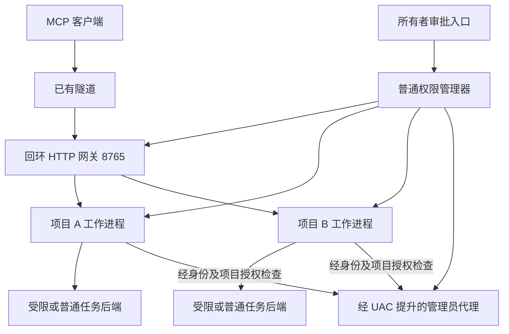

# ShellBot 开发计划

更新日期：2026 年 10 月 10 日。依据：已确认的多项目、多工作目录、独立审批策略和按项目授权的管理员代理设计。

M1 配置与统一策略已在 dev.8 完成：版本化多项目数据模型、三审批模式、独立权限上限及旧配置显式迁移通过本机验证。dev.9 已完成 M2 普通权限管理器、独立工作进程、本机生命周期、配额和故障处理，见 [项目管理器](PROJECT_MANAGER.md)。下一项为 M3 项目路由与认证；M3–M7 未实现。配置入口、兼容行为及证据见 [项目配置说明](PROJECT_CONFIGURATION.md)和 [实现记录](IMPLEMENTATION_STATUS.md)。

本文是后续迭代的主计划；[第一阶段计划](PHASE_1_PLAN.md)保留已有里程碑和验收状态，[权限设计](EXECUTION_PERMISSIONS.md)定义授权边界。发生范围冲突时，以本文和权限设计中本次确认的决定为准。计划中的新功能不代表 dev.7 已实现。

## 当前基线与本次范围

WinShellBot 继续使用 C17，以 Windows 10/11 x64 为主，Windows Server 2025 补充独立验收。通用核心不依赖 Windows 头文件，为 Linux/macOS 保留平台接口；Windows 7/8.1 以后单独编译和验证。

dev.7 已有十三个 MCP 工具、多工作目录、文件阅读搜索、PNG/JPEG 返回、审批写入和修改、私有备份与审计，以及普通/管理员后台任务。本机任务已验证；受限令牌准备和管理调用拒绝不等于完整执行沙箱。当前仍是一实例一份配置、一套凭据和执行策略；管理员代理服务单个主机，不能据此宣称支持多项目共享授权。

继续复用协议适配、工具实现、路径检查、文件修改前置条件、任务输入输出和进程树清理。主要调整配置、权限判断、请求上下文、项目生命周期及管理员通信，不整体重写。

当前不开发公网 OAuth、cloudflared 安装监管、DNS 或域名探测。默认回环 HTTP 端口仍为 8765，用户已有隧道转发到该端口。外部地址可填写并用于生成链接或启用地址限制，不把验证域名作为开发前置条件。远程操作审批属于单独的所有者管理能力，不代表恢复 MCP OAuth 的开发范围。

## 已确认的产品行为

| 能力 | 开发目标 | 当前状态 |
| --- | --- | --- |
| 多项目 | 本机创建、配置、启停项目；各项目独立 MCP 地址、凭据、策略、任务和审计 | M1 配置和 M2 本机项目运行已实现；HTTP 链接与认证待 M3 |
| 多工作目录 | 每项目多个稳定 workspace_id，分别设置读写权限和默认命令目录 | M1 项目归属模型已实现；项目运行接入待完成；旧单实例支持 16 个目录 |
| 三种审批模式 | 每次文件访问及命令审批；工作目录文件自动、命令审批；无需逐次审批 | M1 配置与统一判断已实现；完整操作审批适配待 M4；旧运行行为保留 |
| 目录外访问 | 默认不可见；可增授指定目录只读、读写，或当前账户可访问的全部文件 | M1 项目配置与上限判断已实现；新版实际文件后端接入待完成 |
| 执行身份 | 受限、当前账户普通权限、授权后的管理员权限；与审批模式分开 | 普通/管理员任务可用；完整受限执行待实现 |
| 管理员代理 | 同一管理器下复用提升进程，逐项目授权，不自动扩散到其他项目 | 单主机代理已有；共享及逐项目授权待实现 |
| 本机管理 | 先提供项目配置和命令行生命周期，再做最小管理界面 | M1 配置和 M2 命令行生命周期已实现；界面待 M7 |
| 远程审批 | 所有者在另一设备确认请求；AI 只能申请、查询和取消 | 待实现 |
| 可靠性 | 项目配额、持久任务记录、重启中断状态、完整生命周期审计 | 现有内存任务可复用；持久恢复待实现 |

## 项目架构

采用普通权限管理器、每项目独立工作进程和可共享的管理员代理。初期可复用 WinShellBot.exe 的启动角色，无需立即增加运行时或多个发行二进制。

图中的代理连接不代表项目已获管理员权限。代理必须独立核验调用进程、项目授权和操作条件，拒绝未获授权项目。

HTTP 网关通过 `/projects/{project_id}/mcp` 提供不同项目链接，共用一个本机端口。地址示例为 `https://<用户域名>/projects/project-a/mcp`。路由和认证共同确定项目，项目 A 的凭据不能调用项目 B；工作进程上下文固定，模型传入 project_id 不能改变归属。独立 stdio 或多个程序实例仍可作为部署方式，每实例使用独立数据目录；旧 `/mcp` 只在显式绑定默认项目时保留，不根据客户端参数切换项目。

各项目拥有独立凭据引用、审批队列、备份、任务编号空间、幂等记录、日志和资源预算。相同 workspace_id、task_id 或 request_key 出现在不同项目时不会相互命中。网关限制总请求和排队预算，工作进程限制本项目的并发任务、输出和审批数量；阻塞系统调用交给有界工作队列，不为每个请求无限创建线程。独立进程便于多核调度及故障处理，性能仍需实际并发测试。

管理器负责注册和启停本人工作进程，项目失败不自动重跑有副作用任务。管理员代理由管理器持有，单项目退出不会终止其他项目的代理或任务。管理员能力覆盖本次代理运行期；代理退出后状态变为不可用，不隐式再次弹 UAC。电脑重启后的管理员自动恢复依赖以后开发的服务或计划任务。

## 权限模型与配置迁移

权限判断统一采用：认证和项目绑定 → 工具开关 → 文件范围与执行身份上限 → 当前审批策略 → 实际执行前复核。审批只能批准范围内的操作；扩大目录范围或启用管理员权限属于所有者配置变更，不能由一条 MCP 工具请求完成。

| 独立设置 | 选项或约束 |
| --- | --- |
| 文件范围 | 工作目录；额外目录白名单；当前账户可访问范围。每个位置独立读取/写入权限，默认拒绝目录外访问 |
| 审批模式 | `always`：每次文件访问和命令审批；`workspace_auto`：允许的工作目录内文件读写自动，命令审批，额外目录操作默认审批；`never`：范围内无需逐次审批 |
| 执行身份 | 普通任务默认 `restricted` 或 `current_user`；管理员操作必须显式选择且通过已授权代理执行 |
| 管理员使用许可 | 独立的项目级开关与所有者授权；关闭时，即使共享代理已提升也拒绝调用 |
| 工具和资源 | 独立启用文件、命令、后续桌面等能力，并设并发、输出、期限和保存预算 |

文件访问包括列表、读取、搜索、图像及后续文档阅读；不能通过图片或搜索摘要绕过读取审批。批准一次完整、有预算且绑定目标的逻辑读取，分页继续读取相同版本和范围时可复用该许可，目标变化或增加范围需重新判断。项目基本状态与能力查询无需逐次审批，但只能返回当前项目允许的元数据。

task_status、task_output 必须校验项目和任务归属，输出属于原已授权任务的结果，不因每次轮询重复弹审批。task_input 另作命令交互操作，在需要审批的模式下绑定输入内容和 EOF；task_cancel 始终允许本项目取消本人任务，拒绝跨项目取消。批准命令不等于允许它访问目录外文件；需要这种限制的项目必须采用已验证的受限执行环境。

| 使用者可预先选择的项目配置 | 文件访问 | 命令与身份 | 管理员能力 |
| --- | --- | --- | --- |
| 完整权限项目 | 当前账户可访问的全部文件 | `never`，默认当前账户普通权限 | 可由所有者单独允许；管理员操作仍需可用的 UAC 提升代理 |
| 工作目录项目 | 一个或多个工作目录，目录外拒绝 | `workspace_auto`，命令逐次批准；采用受限执行后端 | 默认禁止 |
| 逐次确认项目 | 明确配置的目录范围 | `always`，受限执行 | 默认禁止 |

前三种审批模式均不自动授予管理员权限。`never` 也不把只读目录变成可写。普通账户完整权限、严格目录隔离、管理员执行之间存在实际操作系统边界；不能将当前账户任意命令包装成严格目录隔离。初期严格受限项目禁止管理员执行，不满足隔离验收时拒绝启动命令后端。

受限后端须明确必要的系统运行资源只读许可，例如程序和系统库；不能因这些运行依赖而向 AI 开放其他用户文件。网络、桌面、凭据和管理对象属于独立资源范围，不能从目录限制推导出它们已经隔离。

新配置加入格式版本。旧单实例配置通过显式迁移生成默认项目，保留根目录权限、文件审批行为及原命令授权范围；不把旧 user/administrator 档自动转换成全盘文件访问或免除文件审批。迁移前保存原配置，不修改旧 Data；未实现的组合报错或显示不可用，未知或重复字段拒绝。

## 共享管理员代理

所有者可以启动前配置 A、B 允许管理员执行、C 禁止，然后启动代理并完成一次 UAC。A、B 的已授权管理员操作复用该代理；C 不获得管理员能力，网关和工作进程继续使用普通令牌。

UAC 提升的是代理进程。已提升代理新增允许项目时，必须由所有者独立确认并更新项目授权；Windows 不会因为增加项目而自然再次弹 UAC。如需每项目首次使用都出现实际 UAC，应使用每项目独立代理，这作为可选运行方式，不作为默认架构。

管理器从可信配置建立授权表和项目工作进程绑定，代理独立验证实际对端、项目、授权版本、操作摘要、期限和需要的批准记录。只检查同账户 SID 或请求内自报 project_id 不足以完成隔离。代理不接收公网连接，不提供模型可调用的注册项目、批准、改策略接口；支持明确限定的命令及需要提升的文件操作，不提供绕过原项目文件范围的通用接口。

撤销项目管理员许可后，拒绝该项目新请求并取消尚未开始的操作；暂停/停用项目同时终止本人受管任务。收窄目录或操作范围后，不继续使用旧审批；活动任务默认取消并按实际结果记录。已经发生的副作用不宣称可回滚，已取得管理员权限的任意代码也不宣称能被完整权限降级。

项目授权检查保护正常调用边界，不代表管理员项目与其他项目具有操作系统级互不干扰。管理员程序可以修改整台电脑；普通账户任意命令也可能访问同账户管理资源。需要对抗这类能力时，另用虚拟机或独立系统，不能只依赖多个工作进程。

## 开发里程碑

以下编号用于安排工作，不表示已交付，也不预先承诺发行版本号。

| 顺序 | 交付内容 | 关键通过条件 |
| --- | --- | --- |
| M1 项目配置与统一策略（已完成） | 项目数据模型、版本化配置、多个目录、三审批模式、目录外策略、执行身份和管理员许可解耦；旧配置显式迁移 | dev.8 Debug/Release 专项各 405 项通过；新配置运行尚未开放；真实审批和受限执行仍待 M4 |
| M2 管理器与项目工作进程（本机自动验收完成） | 项目创建/配置/启停的命令行入口、独立数据目录和凭据、项目请求上下文及资源预算 | 两项目同时运行；相同幂等键与任务编号不串项目；一项目停止或失败不影响另一项目；只清理本人进程 |
| M3 独立 MCP 链接 | 回环网关、项目路由、逐项目认证、默认项目兼容路径、链接生成及多项目并发 | A 令牌访问 B 被拒绝；伪造 project_id、并发及重复请求不串上下文；一个现有隧道可承载多个地址 |
| M4 完整审批与受限执行 | 全部文件工具与命令统一经过策略；本机审批适配；受限身份、对象 ACL、执行环境及管理资源保护 | always 下未批准不泄露文件正文或产生修改；workspace_auto 文件自动而命令等待；批准命令仍不能访问未授权位置、自批、改配置或调用管理员代理 |
| M5 共享管理员代理 | 管理器持有代理、可信项目注册、逐项目操作验证、授权更新/撤销、管理员文件与命令后端 | A/B 已允许、C 禁止；一次启动 UAC 后 A/B 多任务复用、C 拒绝；新增项目需所有者授权；真实令牌不误继承；撤销和项目退出按归属处理 |
| M6 无人值守审批与可靠性 | 独立所有者远程审批入口、支持客户端的交互提示、持久请求/任务记录、完整生命周期审计 | 另一设备可查看/批准/拒绝；MCP 令牌不能批准；参数变化/过期/策略收窄拒绝；重启标记中断、不自动重跑或重复写入 |
| M7 管理界面与候选验收 | 最小项目管理界面、地址与权限状态、暂停和诊断；独立便携候选包 | Windows 10/11 与 Server 2025 分别记录实际运行；真实 MCP 客户端分别连接不同项目，完成文件、图像、审批和任务操作；既有故障如实保留 |

M1/M2 的代码与本机自动验证已完成，下一项代码开发为 M3。严格目录隔离命令在 M4 通过前保持不可用；M2/M3 不以未完成隔离作为允许受限命令的理由。M5 中管理员能力只向已预先信任的项目开放，不能借它实现严格受限命令。M6 的远程审批绑定结构已在 M1 定义，运行入口在 M6 交付，不要求受控电脑前逐条确认。

文件、任务和图像旧功能在每次改动涉及的范围内回归。M4/M5 使用原生测试辅助程序检查真实身份和进程，保留用户观察的 UAC 次数与脚本结果的区别；不采用编码 PowerShell 子命令作为测试载荷。文档修改本身不重复运行管理员专项或引起 UAC。

## 后续功能

完成项目和权限基础后，继续 Windows 桌面截图、窗口、鼠标键盘、剪贴板；同一用户桌面跨项目使用独占租约，避免并发输入相互干扰。文件/文档任务可按项目并发，但桌面能力不会因目录受限自动变安全。

随后开发图像完整解码缩放、PDF/Office 阅读与页面预览、受控产物传输；再按需求增加 OCR、专用浏览器、服务/计划任务启动、升级回滚及跨平台版本。公网 OAuth 与隧道管理保持暂缓，只有用户重新确认范围后排入开发。

## 交付与验证记录

每个里程碑明确列出代码完成、开发机自动验证、独立机器验收和实际 MCP 客户端验收，不相互替代。当前 HTTP close 偶发重置继续保留待调查状态，不以单轮零失败宣布修复。

候选包使用独立目录，记录源码状态、程序摘要、配置版本和测试范围，不包含用户数据、凭据和日志。保留 dev.6/dev.7 包及原始报告；发布、推送或替换用户已有数据另按用户授权执行。2026 年 10 月 9 日计划调整仅修改文档；10 月 10 日 M1 由用户提交和推送为 5f9d177；随后 M2 本地开发验证，未生成新包、修改实际配置或用户 Data，也未提交或推送 M2。
