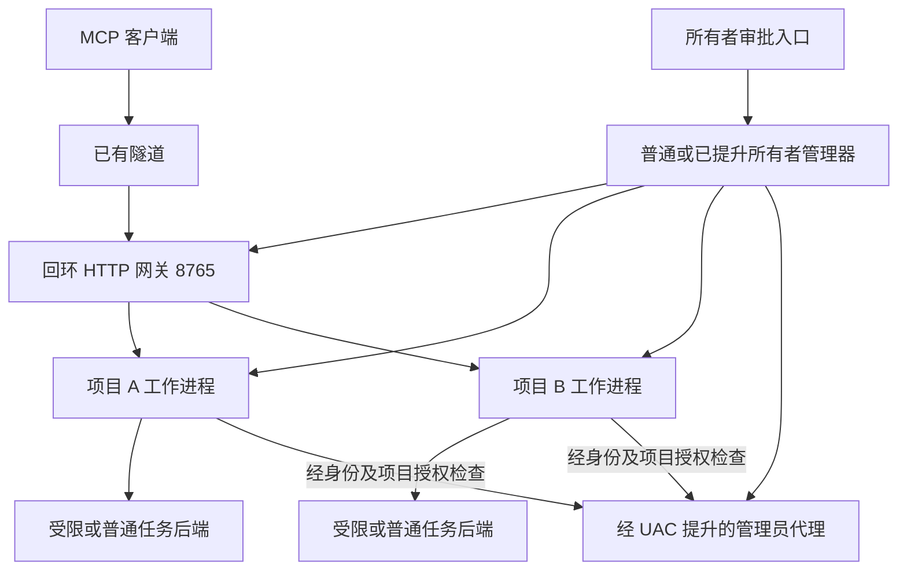

2026-10-21 / M19 dev.26：用户要求优先解决授权问题，支持无人值守电脑首次确认后持续授权至手动取消。实现显式长期授权、原项目绑定、当前权限逐次检查、旧格式迁移及续期诊断；保留短期访问令牌、严格续期轮换和 issuer/PKCE 校验。完成新版本回归后生成候选包，远端命令测试暂缓。详见 [M19 交接](HANDOFF_20261021_PERSISTENT_AUTH.md)。

2026-10-21 / M18 dev.25：优先修正用户报告的频繁授权与按钮刷新闪烁，完成准确新程序的原生 UI、OAuth、普通功能和完整 HTTP 回归后生成测试包。保留用户需要的 localhost 过滤，使用固定程序路径排除；不扩大代理、浏览器或系统 Python 的排除范围。真实客户端 issuer 问题继续单列，不通过关闭认证或放宽校验处理。详见 [M18 交接](HANDOFF_20261021_AUTH_REFRESH.md)。

2026-10-21 / M17 dev.24：HTTP 关闭流程加固与 AdGuard 回环过滤因果对照已记录。新包要求完整 EOF 和全部本机功能回归通过；当时环境为 AdGuard 服务运行、用户关闭 localhost 过滤。本地代理过滤影响和按应用排除方案单列，真实 MCP 客户端与新版本实际管理员仍待验。详见 [M17 交接](HANDOFF_20261021_HTTP_EOF.md)。

# ShellBot 开发计划

2026-10-21 / M16 dev.23：按用户新要求改为便携数据布局，默认程序目录 Data；界面可选非 C 盘位置，迁移先复制核验、再保存新位置并提示重开与手动清理。ShellBot 自身数据拒绝 C 盘，明确授权的 C 盘文件操作保留。应用与项目路径、工作进程缓存和临时目录统一处理；不创建 AppContainer 磁盘配置，使用内存 LowBox 令牌并保留原 LPAC 验证。测试、候选包、失败和外部验收分别记录，旧 OAuth 包保留回滚。

2026-10-21 / M15：用户授权补齐 OAuth 2.1，集成管理界面，配置 HTTPS 公网地址后自动启用，浏览器申请由本机所有者确认；完成本机回归和重新打包后再做真实客户端验收，最后仅清理核验无用的旧包和可重建缓存，保留项目数据、回滚包及验证证据。本条覆盖 M14 的 OAuth 不扩展范围。

2026-10-20 最新范围变更 / M14：用户要求重构为单一管理界面入口，在界面中新建和配置项目、立即更新列表、编辑项目存储目录，关闭收进托盘、右键退出停止全部项目，取消日常 CMD 控制。dev.21 按此实现 GUI 直接持有管理器、运行中增加/编辑项目、每项目加密保存和可校验的目录复制迁移；复用已有 MCP/文件/权限/HTTP 后端，不扩展工具、OAuth、隧道或域名管理。本条覆盖下方 M13“本轮不开发新功能”的旧停点。验证与交付见最新交接。

2026-10-20 收尾范围：用户要求先完成 M13 真实配置/文件/HTTP、修正收据、回归和候选打包，不开发新功能。当前状态和失败保留见 [M13 交接](HANDOFF_20261020_M13.md)。

2026-10-20 / M13：配置表单、原生文件工具、真实 owner/worker/管理员操作和 HTTP 本机收尾验证已通过；普通回归各 16 份，Debug 7184 / Release 7216 项，另有界面/管理员及两套各 5000 次 TCP 对照。收据成功判断和配置明确长度解析已修复，候选生成与解压实测另绑定收据；独立系统和真实客户端待验。详见 [M13 交接](HANDOFF_20261020_M13.md)。

更新日期：2026 年 10 月 17 日。依据：已确认的多项目、多工作目录、独立审批策略和按项目授权的管理员代理设计。

dev.8–13 已接通 M1–M6；dev.14 提供 [M7 原生管理窗口和独立候选包](PROJECT_MANAGEMENT_UI.md)。本机开发与实际窗口/UAC 验证已完成；独立机器、另一设备/代理和实际客户端验收仍待完成。

用户已提交并同步 M11，当前基准 `051bf77a87243ec7ff6bfe4ac3d69d77acb247c2`。dev.15 提供 [M8 Windows 桌面工具](DESKTOP_CONTROL.md)，dev.16 实现 [M9 图像完整解码与缩放](IMAGE_VIEW.md)，dev.17 实现 [M10 PDF / Office 阅读与预览](DOCUMENT_READING.md)，dev.18 实现 [M11 受控产物上传和下载](ARTIFACT_TRANSFER.md)，dev.19 按用户最新调整同时开发 [M12 服务和托盘常驻](STARTUP.md)。服务/托盘已有本机人工证据，2026-10-17 新增已提升管理器和最高权限登录计划任务。用户明确以 Windows 登记与回读设置验收，不要求重启或注销；其他阶段待办按各自收据保留。各功能的本机验证和人工/独立验收分别记录，不替代原 M7 外部验收。

本文是后续迭代的主计划；[第一阶段计划](PHASE_1_PLAN.md)保留已有里程碑和验收状态，[权限设计](EXECUTION_PERMISSIONS.md)定义授权边界。发生范围冲突时，以本文和权限设计中本次确认的决定为准。计划中的新功能不代表 dev.7 已实现。

## 当前基线与本次范围

WinShellBot 继续使用 C17，以 Windows 10/11 x64 为主，Windows Server 2025 补充独立验收。通用核心不依赖 Windows 头文件，为 Linux/macOS 保留平台接口；Windows 7/8.1 以后单独编译和验证。

dev.7 当时已有十三个 MCP 工具、多工作目录、文件阅读搜索、PNG/JPEG 返回、审批写入和修改、私有备份与审计，以及普通/管理员后台任务。当时为一实例一份配置、一套凭据和执行策略，管理员代理服务单个主机。当前 M1–M7 多项目与共享代理以各阶段实际记录为准，不能从早期令牌准备推断完整隔离。

继续复用协议适配、工具实现、路径检查、文件修改前置条件、任务输入输出和进程树清理。主要调整配置、权限判断、请求上下文、项目生命周期及管理员通信，不整体重写。

当前不开发公网 OAuth、cloudflared 安装监管、DNS 或域名探测。默认回环 HTTP 端口仍为 8765，用户已有隧道转发到该端口。外部地址可填写并用于生成链接或启用地址限制，不把验证域名作为开发前置条件。远程操作审批属于单独的所有者管理能力，不代表恢复 MCP OAuth 的开发范围。

## 已确认的产品行为

| 能力 | 开发目标 | 当前状态 |
| --- | --- | --- |
| 多项目 | 本机创建、配置、启停项目；各项目独立 MCP 地址、凭据、策略、任务和审计 | M1 配置、M2 本机项目运行和 M3 HTTP 地址/认证已实现 |
| 多工作目录 | 每项目多个稳定 workspace_id，分别设置读写权限和默认命令目录 | 项目运行已接入，工作目录与额外目录各最多 16；旧单实例共 16 |
| 三种审批模式 | 每次文件访问及命令审批；工作目录文件自动、命令审批；无需逐次审批 | M4 接通六个文件工具、task_start/task_input；旧运行行为保留 |
| 目录外访问 | 默认不可见；可增授指定目录只读、读写，或当前账户可访问的全部文件 | M4 接通额外目录和当前账户绝对本地路径；显式只读上限保留 |
| 执行身份 | 受限、当前账户普通权限、授权后的管理员权限；与审批模式分开 | M4 LPAC 与普通任务、M5 显式管理员可用；受限项目不允许管理员 |
| 管理员代理 | 同一管理器下复用提升进程，逐项目授权，不自动扩散到其他项目 | M5 可信注册、独立操作校验、授权版本和撤销、文件/任务后端已接通 |
| 本机管理 | 先提供项目配置和命令行生命周期，再做最小管理界面 | M7 原生状态/地址/权限、启停、暂停/恢复和诊断窗口已接通；配置仍显式导出并重启 |
| 远程审批 | 所有者在另一设备确认请求；AI 只能申请、查询和取消 | M6 独立认证、页面/API 与客户端提示已接通；另一设备和已有代理待验收 |
| 可靠性 | 项目配额、持久任务记录、重启中断状态、完整生命周期审计 | M6 受保护有界历史、重启中断与生命周期审计已接通；不自动重放 |
| Windows 桌面 | 独立观察/输入/剪贴板授权，会话独占控制、人工暂停和本地恢复 | M8 / dev.15 普通会话后端已接通；真实物理操作、多显示器/会话变化与独立系统分别验收 |

## 项目架构

采用每项目独立普通工作进程和可共享的管理员代理。管理器默认普通权限，也接受同账户、同会话的已提升所有者；后者复用已有权限创建代理，不能把默认工作进程提升。复用 WinShellBot.exe 的角色，登录使用相邻原生 GUI 启动器。

图中的代理连接不代表项目已获管理员权限。代理必须独立核验调用进程、项目授权和操作条件，拒绝未获授权项目。

HTTP 网关通过 `/projects/{project_id}/mcp` 提供不同项目链接，共用一个本机端口。地址示例为 `https://<用户域名>/projects/project-a/mcp`。路由和认证共同确定项目，项目 A 的凭据不能调用项目 B；工作进程上下文固定，模型传入 project_id 不能改变归属。独立 stdio 或多个程序实例仍可作为部署方式，每实例使用独立数据目录；旧 `/mcp` 只在显式绑定默认项目时保留，不根据客户端参数切换项目。

各项目拥有独立凭据引用、审批队列、备份、任务编号空间、幂等记录、日志和资源预算。相同 workspace_id、task_id 或 request_key 出现在不同项目时不会相互命中。网关限制总请求和排队预算，工作进程限制本项目的并发任务、输出和审批数量；阻塞系统调用交给有界工作队列，不为每个请求无限创建线程。独立进程便于多核调度及故障处理，性能仍需实际并发测试。

管理器负责注册和启停本人工作进程，项目失败不自动重跑有副作用任务。管理员代理由管理器持有，单项目退出不会终止其他项目的代理或任务。代理退出后不可用，不隐式再次弹 UAC。dev.19 提供 Windows 最高权限交互登录计划任务，首次由已提升所有者登记，之后由 Windows 启动；已提升管理器自动创建一次已配置代理，显式重启代理复用同一权限。服务仍使用独立非管理员虚拟账户。

## 权限模型与配置迁移

权限判断统一采用：认证和项目绑定 → 工具开关 → 文件范围与执行身份上限 → 当前审批策略 → 实际执行前复核。审批只能批准范围内的操作；扩大目录范围或启用管理员权限属于所有者配置变更，不能由一条 MCP 工具请求完成。

| 独立设置 | 选项或约束 |
| --- | --- |
| 文件范围 | 工作目录；额外目录白名单；当前账户可访问范围。每个位置独立读取/写入权限，默认拒绝目录外访问 |
| 审批模式 | `always`：每次文件访问和命令审批；`workspace_auto`：允许的工作目录内文件读写自动，命令审批，额外目录操作默认审批；`never`：范围内无需逐次审批 |
| 执行身份 | 普通任务默认 `restricted` 或 `current_user`；管理员操作必须显式选择且通过已授权代理执行 |
| 管理员使用许可 | 独立的项目级开关与所有者授权；关闭时，即使共享代理已提升也拒绝调用 |
| 工具和资源 | 独立启用文件、命令、后续桌面等能力，并设并发、输出、期限和保存预算 |

文件访问包括列表、读取、搜索、图像及后续文档阅读；不能通过图片或搜索摘要绕过读取审批。批准一次完整、有预算且绑定目标的逻辑读取，分页继续读取相同版本和范围时可复用该许可，目标变化或增加范围需重新判断。项目基本状态与能力查询无需逐次审批，但只能返回当前项目允许的元数据。

task_status、task_output 必须校验项目和任务归属，输出属于原已授权任务的结果，不因每次轮询重复弹审批。task_input 另作命令交互操作，在需要审批的模式下绑定输入内容和 EOF；task_cancel 始终允许本项目取消本人任务，拒绝跨项目取消。批准命令不等于允许它访问目录外文件；需要这种限制的项目必须采用已验证的受限执行环境。

| 使用者可预先选择的项目配置 | 文件访问 | 命令与身份 | 管理员能力 |
| --- | --- | --- | --- |
| 完整权限项目 | 当前账户可访问的全部文件 | `never`，默认当前账户普通权限 | 可由所有者单独允许；管理员操作仍需可用的 UAC 提升代理 |
| 工作目录项目 | 一个或多个工作目录，目录外拒绝 | `workspace_auto`，命令逐次批准；采用受限执行后端 | 默认禁止 |
| 逐次确认项目 | 明确配置的目录范围 | `always`，受限执行 | 默认禁止 |

前三种审批模式均不自动授予管理员权限。`never` 也不把只读目录变成可写。普通账户完整权限、严格目录隔离、管理员执行之间存在实际操作系统边界；不能将当前账户任意命令包装成严格目录隔离。初期严格受限项目禁止管理员执行，不满足隔离验收时拒绝启动命令后端。

受限后端须明确必要的系统运行资源只读许可，例如程序和系统库；不能因这些运行依赖而向 AI 开放其他用户文件。网络、桌面、凭据和管理对象属于独立资源范围，不能从目录限制推导出它们已经隔离。

新配置加入格式版本。旧单实例配置通过显式迁移生成默认项目，保留根目录权限、文件审批行为及原命令授权范围；不把旧 user/administrator 档自动转换成全盘文件访问或免除文件审批。迁移前保存原配置，不修改旧 Data；未实现的组合报错或显示不可用，未知或重复字段拒绝。

## 共享管理员代理

所有者可以启动前配置 A、B 允许管理员执行、C 禁止，然后启动代理并完成一次 UAC。A、B 的已授权管理员操作复用该代理；C 不获得管理员能力，网关和工作进程继续使用普通令牌。

UAC 提升的是代理进程。已提升代理新增允许项目时，必须由所有者独立确认并更新项目授权；Windows 不会因为增加项目而自然再次弹 UAC。如需每项目首次使用都出现实际 UAC，应使用每项目独立代理，这作为可选运行方式，不作为默认架构。

管理器从可信配置建立授权表和项目工作进程绑定，代理独立验证实际对端、项目、授权版本、操作摘要、期限和需要的批准记录。只检查同账户 SID 或请求内自报 project_id 不足以完成隔离。代理不接收公网连接，不提供模型可调用的注册项目、批准、改策略接口；支持明确限定的命令及需要提升的文件操作，不提供绕过原项目文件范围的通用接口。

撤销项目管理员许可后，拒绝该项目新请求并取消尚未开始的操作；暂停/停用项目同时终止本人受管任务。收窄目录或操作范围后，不继续使用旧审批；活动任务默认取消并按实际结果记录。已经发生的副作用不宣称可回滚，已取得管理员权限的任意代码也不宣称能被完整权限降级。

项目授权检查保护正常调用边界，不代表管理员项目与其他项目具有操作系统级互不干扰。管理员程序可以修改整台电脑；普通账户任意命令也可能访问同账户管理资源。需要对抗这类能力时，另用虚拟机或独立系统，不能只依赖多个工作进程。

## 开发里程碑

以下编号用于安排工作，不表示已交付，也不预先承诺发行版本号。

| 顺序 | 交付内容 | 关键通过条件 |
| --- | --- | --- |
| M1 项目配置与统一策略（已完成） | 项目数据模型、版本化配置、多个目录、三审批模式、目录外策略、执行身份和管理员许可解耦；旧配置显式迁移 | dev.8 专项各 405 项通过；运行与真实审批分别由 M2/M4 接入，dev.11 配置/策略回归各 418 项 |
| M2 管理器与项目工作进程（本机自动验收完成） | 项目创建/配置/启停的命令行入口、独立数据目录和凭据、项目请求上下文及资源预算 | 两项目同时运行；相同幂等键与任务编号不串项目；一项目停止或失败不影响另一项目；只清理本人进程 |
| M3 独立 MCP 链接（本机自动验收完成） | 回环网关、项目路由、逐项目认证、默认项目兼容路径、链接生成及多项目并发 | A 令牌访问 B 被拒绝；伪造 project_id、并发及重复请求不串上下文；慢请求和工作进程通信超时不阻断其他项目；实际已有隧道与客户端验收待完成 |
| M4 完整审批与受限执行（本机自动验收完成） | 六个文件工具与命令统一审批；有界分页；真实 LPAC、目录 ACL、环境和管理对象保护；只读运行资源与恢复日志 | 未批准无正文/副作用；真实原生程序对照通过外部文件、只读目录、管理 Data、审批管道、注入、网络、Win32k、子进程及联接检查；其他系统与通用程序兼容性仍待验收 |
| M5 共享管理员代理（本机及人工 UAC 验收完成） | 管理器持有代理、可信项目注册、逐项目操作验证、授权更新/撤销、管理员文件与命令后端 | A/B 已允许、C 禁止；一次启动 UAC 后 A/B 多任务复用、C 拒绝；新增项目需所有者授权；真实令牌不误继承；撤销和项目退出按归属处理；人工及脚本证据见 M5 交接 |
| M6 无人值守审批与可靠性（本机验证，跨设备待验收） | 独立所有者页面/API、2026 URL 提示、本人查询/取消、受保护有界历史及生命周期审计 | 本机 HTTP、真实浏览器与 UAC 专项；旧批准不恢复、输入不重投；另一设备、实际代理和 MCP 客户端须分别验收 |
| M7 管理界面与候选验收（本机候选验证，外部验收待完成） | 原生项目状态/地址/权限窗口、启停、暂停、诊断；独立便携候选包 | 开发机真实窗口/UAC 与解压程序分别记录；Windows 10/Server 2025、另一设备/代理和真实 MCP 客户端待验收；既有故障如实保留 |
| M8 Windows 桌面工具（dev.15 本机开发） | 截图、窗口、物理坐标输入、纯文本剪贴板；跨管理器独占租约、输入暂停和紧急停止；统一审批与脱敏历史 | 专用窗口验证真实像素和输入、陈旧观察拒绝、并发和异常退出；人工托盘/停止、锁屏/RDP、多缩放显示器及实际客户端单独验收 |
| M9 图像完整解码与缩放（dev.16 本机开发） | PNG/JPEG 全部像素解码、PNG 压缩行完整性、源尺寸/像素预算、保持比例与自适应缩小、源/结果摘要 | 独立解码器核对真实像素及透明度；损坏、压缩边界和审批参数拒绝；真实客户端与独立环境另行验收 |
| M10 PDF / Office 阅读与预览（dev.17 本机开发） | PDF 文本/页面 PNG；DOCX 正文、XLSX 工作表存储值、PPTX 幻灯片文本；有界 Unicode 分页及明确标注的 Office 内容预览 | 真实 PDF/OPC 包、独立 PNG 解码、篡改/预算/审批与跨项目拒绝；实际 UAC 保护文件读取；原始 Office 排版、OCR、真实客户端和独立系统分别保留待办 |
| M11 受控产物传输（dev.18 本机开发） | 项目授权的二进制分块上传/下载、大小与摘要、禁止覆盖、原许可撤销/期限及独立后端归属；私有上传暂存和最近块重试 | 真实 HTTP 多 MiB 字节、跨项目/actor、只读/审批/摘要/重试/配额、取消/到期/重启清理；管理员保护文件/目录专项待人工配合，客户端附件和独立系统另行验收 |
| M12 常驻与自动启动（dev.19，Windows 登记设置验收） | 私有加密快照、项目选择、无控制台启动器、托盘显隐/退出；普通 Run 或最高权限登录任务；独立虚拟账户 SCM 服务；已提升管理器复用管理员令牌 | 登录登记、实际 SCM/虚拟账户及物理托盘已有本机证据；管理员启动/最高权限任务专项 307 项通过。按用户最新范围不要求真实重启/注销；外部环境仍单列 |

M1–M7 本机路径已接通，M8 桌面工具按用户继续开发的指令推进；M7 外部验收仍独立保留。M4 每次启动核验 LPAC 和授权资源，失败不退回账户任务，初期不开放子进程、网络或 Win32k。M5 仅向预先信任项目开放，运行期授权不自动写回配置，各 backend 分别计配额。M6/M7 加载历史并中断旧许可，不自动重跑；本机窗口、浏览器或 UAC 不替代跨设备及真实 MCP 客户端验收。

文件、任务和图像旧功能在每次改动涉及的范围内回归。M4/M5 使用原生测试辅助程序检查真实身份和进程，保留用户观察的 UAC 次数与脚本结果的区别；不采用编码 PowerShell 子命令作为测试载荷。文档修改本身不重复运行管理员专项或引起 UAC。

## 后续功能

M8 已接入 Windows 桌面截图、窗口、鼠标键盘、纯文本剪贴板；同一用户桌面跨项目使用独占租约，避免并发输入相互干扰。文件/文档任务可按项目并发，但桌面能力不会因目录受限自动变安全。

图像完整解码与缩放由 M9 实现，PDF / Office 阅读与预览由 M10 接入，受控产物上传/下载由 M11 实现，M12 按用户确认同时提供 Windows 服务和托盘模式。M12 自启验收以 Windows 实际登记设置为准，不要求重启；其他阶段人工结果按最新验收记录核对；Office 原始排版、OCR、专用浏览器、升级回滚及跨平台版本再按需求推进。公网 OAuth 与隧道管理保持暂缓，只有用户重新确认范围后排入开发。

## 交付与验证记录

每个里程碑明确列出代码完成、开发机自动验证、独立机器验收和实际 MCP 客户端验收，不相互替代。当前 HTTP close 偶发重置继续保留待调查状态，不以单轮零失败宣布修复。

候选包使用独立目录，记录源码、摘要、格式和测试范围，不包含用户数据或凭据。用户已提交 M11，当前 HEAD 为 051bf77；origin/main 本地引用一致，未重新查询远端。M12 为未提交、未推送的本地开发更改，没有修改实际用户配置、Data 或隧道；Windows 服务和启动项仅操作有清单约束的独立测试实例。保留旧包与 dev.7–18 基线，当前边界见 [M12 交接](HANDOFF_20261012_M12.md)，原候选记录见 [M7 交接](HANDOFF_20261011_M7.md)。新候选还需适配当前验收门槛、PDFium DLL/完整许可和新原生启动器，不复用 M7 冻结收据。
